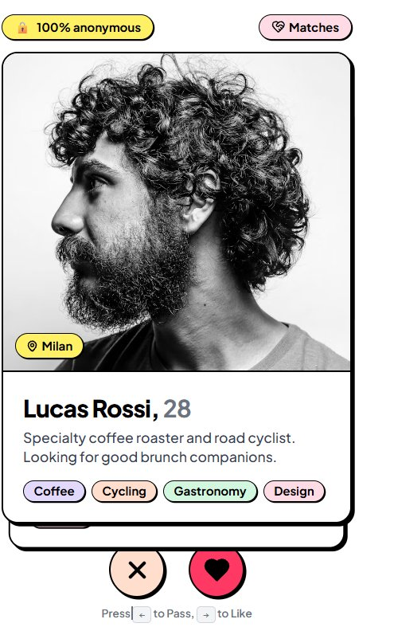
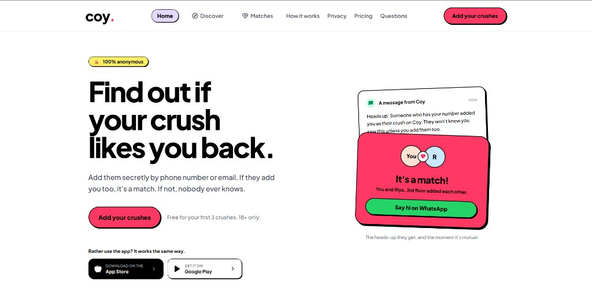
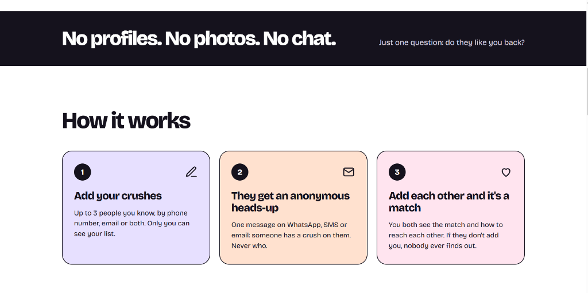
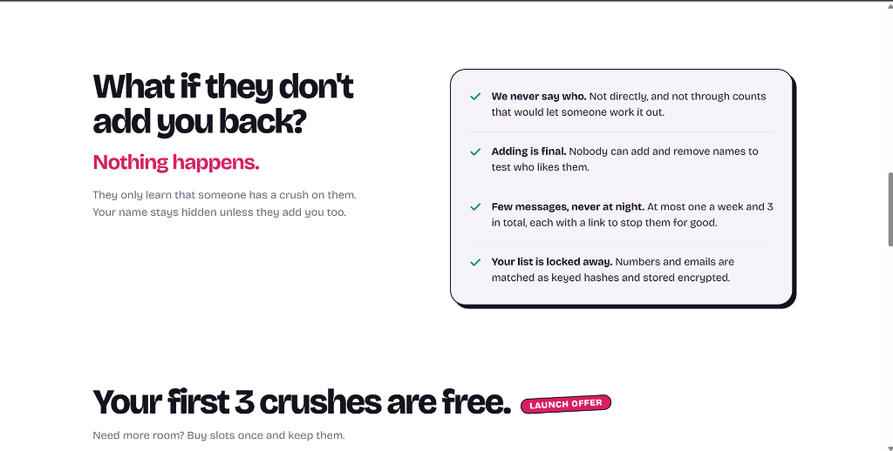
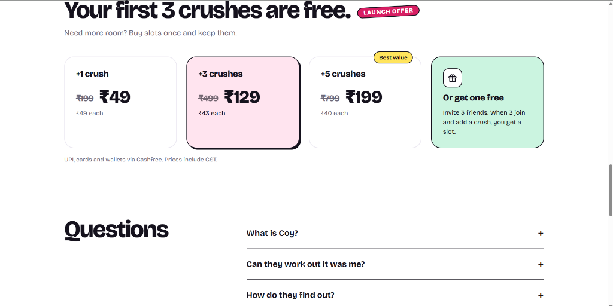

# Coy Discover — Standalone Swipe Discovery & Mutual Matching Experience


## 📸 Visual Showcase & Screenshots

### 1. Discover Swipe Experience
The core profile discovery card featuring mobile drag gestures, neo-brutalist pop styling, interest tags, and keyboard shortcuts (`←` Pass / `→` Like).



### 2. Coy Brand Identity & Match Celebration Modal
The brand-aligned visual identity featuring the lowercase `coy.` wordmark with berry dot, "100% anonymous" guarantee badge, and the signature "It's a match!" mutual connection dialog with WhatsApp integration.



### 3. How It Works
Interactive step-by-step explanation cards in Coy's signature pastel palette (Soft Lavender `#E2D9FC`, Warm Peach `#FFDECE`, and Soft Pink `#FFDCE5`).



### 4. Privacy Guarantees ("What if they don't add you back?")
Clear reassurance on double-blind matching and encrypted data storage with emerald verification checks.



### 5. Pricing & Questions (FAQ)
Interactive neo-brutalist pricing slot cards and expandable question accordions.



---

## 1. Project Overview

**Coy Discover** extends Coy’s discreet, double-blind matching philosophy into an interactive profile discovery feed.

- **Single Demo Identity:** Operates with a trusted demo identity (`demo-user`) managed backend-side without requiring external authentication.
- **Double-Blind Mutual Matching:** Outgoing likes (`LIKE`) and passes (`PASS`) are stored persistently. A match is formed **only** when two users have mutually liked each other.
- **Strict Privacy Invariant:** Unreciprocated incoming likes are **never exposed** through API fields, counts, badges, or styling.
- **Full Database Persistence:** Decisions and mutual connections are stored in SQLite via Prisma ORM 5—refreshing the browser or restarting servers preserves all state.
- **Top Navigation Architecture:** `Home`, `Discover`, and `Matches` tabs are located in the upper header bar with real-time active indicators.

---

## 2. Tech Stack

### Frontend
- **Framework:** Next.js 14 (App Router)
- **Language:** TypeScript 5.6
- **Styling:** Tailwind CSS with custom Coy Neo-Brutalist design tokens
- **Typography:** Plus Jakarta Sans (ultra-bold 900 headings, tight tracking `-0.04em`)
- **Gestures & Motion:** Framer Motion (touch/drag physics, velocity thresholds, exit animations)
- **Icons:** Lucide React

### Backend (Modular Monolith)
- **Runtime:** Node.js (LTS)
- **Framework:** Express.js 4
- **Architecture:** Domain-Driven Modular Monolith (`core/` foundation + isolated domain modules)
- **Language:** TypeScript 5.6 (compiled with `tsc`)
- **Validation:** Zod schemas for request validation
- **Database & ORM:** SQLite 3 with Prisma ORM 5

---

## 3. Modular Monolithic Backend Architecture

Rather than a fragile layered design, the backend is organized into bounded contexts where each module encapsulates its own routes, controller, service, and types.

```
backend/src/
├── core/                               # Foundational infrastructure
│   ├── config/index.ts                 # Environment configuration singleton
│   ├── database/prisma.ts              # PrismaClient database connection singleton
│   ├── errors/app-error.ts             # Standardized operational error classes
│   └── middleware/
│       ├── demo-user.middleware.ts     # Injects trusted demoUserId into request context
│       └── error.middleware.ts         # Centralized HTTP error handler
│
├── modules/                            # Domain-Driven feature modules
│   ├── feed/                           # Discover Feed Domain
│   │   ├── feed.types.ts               # Public DTOs & response contracts
│   │   ├── feed.service.ts             # Feed queries with swiped-user & self exclusions
│   │   ├── feed.controller.ts          # HTTP request/response handler
│   │   ├── feed.routes.ts              # /feed and /api/feed endpoints
│   │   └── index.ts
│   │
│   ├── swipe/                          # Swipe & Decision Domain
│   │   ├── swipe.types.ts              # LIKE / PASS action enums & result types
│   │   ├── swipe.validator.ts          # Zod schema validation
│   │   ├── swipe.service.ts            # Atomic Prisma transactions & match engine
│   │   ├── swipe.controller.ts
│   │   ├── swipe.routes.ts             # /swipe and /api/swipe endpoints
│   │   └── index.ts
│   │
│   ├── match/                          # Mutual Match Domain
│   │   ├── match.types.ts              # Mutual connection public DTOs
│   │   ├── match.service.ts            # Match list queries with canonical user mapping
│   │   ├── match.controller.ts
│   │   ├── match.routes.ts             # /matches and /api/matches endpoints
│   │   └── index.ts
│   │
│   └── system/                         # System Utilities
│       ├── system.routes.ts            # Health check (/health) & Demo reset (/reset)
│       └── index.ts
│
├── app.ts                              # Express app composer & CORS setup
└── server.ts                           # Server listener on port 4000
```

---

## 4. Database Schema & Invariants

```prisma
datasource db {
  provider = "sqlite"
  url      = env("DATABASE_URL")
}

generator client {
  provider = "prisma-client-js"
}

model User {
  id             String    @id
  createdAt      DateTime  @default(now())
  profile        Profile?
  outgoingSwipes Swipe[]   @relation("OutgoingSwipes")
  incomingSwipes Swipe[]   @relation("IncomingSwipes")
  matchesAsUser1 Match[]   @relation("MatchesAsUser1")
  matchesAsUser2 Match[]   @relation("MatchesAsUser2")
}

model Profile {
  id            String   @id @default(cuid())
  userId        String   @unique
  user          User     @relation(fields: [userId], references: [id], onDelete: Cascade)
  name          String
  age           Int
  photoUrl      String
  bio           String
  cityOrCollege String
  interests     String   // Serialized JSON array of strings
  createdAt     DateTime @default(now())
  updatedAt     DateTime @updatedAt
}

enum SwipeAction {
  LIKE
  PASS
}

model Swipe {
  id         String      @id @default(cuid())
  fromUserId String
  toUserId   String
  action     SwipeAction
  createdAt  DateTime    @default(now())

  fromUser   User        @relation("OutgoingSwipes", fields: [fromUserId], references: [id], onDelete: Cascade)
  toUser     User        @relation("IncomingSwipes", fields: [toUserId], references: [id], onDelete: Cascade)

  // Invariant: One swipe per directed user pair
  @@unique([fromUserId, toUserId])
  @@index([fromUserId])
  @@index([toUserId])
}

model Match {
  id        String   @id @default(cuid())
  user1Id   String
  user2Id   String
  createdAt DateTime @default(now())

  user1     User     @relation("MatchesAsUser1", fields: [user1Id], references: [id], onDelete: Cascade)
  user2     User     @relation("MatchesAsUser2", fields: [user2Id], references: [id], onDelete: Cascade)

  // Invariant: Exactly one match record per user pair, sorted canonically (user1Id < user2Id)
  @@unique([user1Id, user2Id])
  @@index([user1Id])
  @@index([user2Id])
}
```

### Critical Database Invariants
1. **No Self-Swiping:** The application rejects `fromUserId === toUserId` with HTTP 400.
2. **Duplicate Swipe Prevention:** Compound unique index `UNIQUE(fromUserId, toUserId)` prevents duplicate actions.
3. **Canonical Match Ordering:** Before storing a match, user IDs are sorted lexicographically: `user1Id = min(A, B)` and `user2Id = max(A, B)`. Compound unique constraint `UNIQUE(user1Id, user2Id)` prevents race-condition duplicates.
4. **Transaction Atomicity:** Swipes and reverse-like checks run inside a `prisma.$transaction`.

---

## 5. API Specification

All endpoints are mounted on both root paths (`/feed`, `/swipe`, `/matches`) and `/api` prefixes (`/api/feed`, etc.).

### 5.1 GET `/feed`
Returns discoverable profiles that the current user has not yet swiped on.

**Sample Response (`200 OK`):**
```json
{
  "profiles": [
    {
      "id": "cm4...1",
      "userId": "user-01",
      "name": "Elena Rostova",
      "age": 25,
      "photoUrl": "https://images.unsplash.com/photo-1534528741775-53994a69daeb?auto=format&fit=crop&w=800&q=80",
      "bio": "Architecture photographer, sourdough experimenter, and slow coffee enthusiast.",
      "cityOrCollege": "London",
      "interests": ["Architecture", "Photography", "Art", "Coffee"]
    }
  ],
  "hasMore": false
}
```

### 5.2 POST `/swipe`
Records a directional swipe (`LIKE` or `PASS`) and calculates mutual match state.

**Request Payload:**
```json
{
  "targetUserId": "user-01",
  "action": "LIKE"
}
```

**Response — Mutual Match (`200 OK`):**
```json
{
  "success": true,
  "swipe": {
    "targetUserId": "user-01",
    "action": "LIKE"
  },
  "matched": true,
  "match": {
    "id": "cm4...m1",
    "profile": {
      "id": "cm4...1",
      "userId": "user-01",
      "name": "Elena Rostova",
      "age": 25,
      "photoUrl": "https://images.unsplash.com/photo-1534528741775-53994a69daeb?auto=format&fit=crop&w=800&q=80",
      "cityOrCollege": "London",
      "bio": "Architecture photographer, sourdough experimenter, and slow coffee enthusiast.",
      "interests": ["Architecture", "Photography", "Art", "Coffee"]
    }
  }
}
```

**Response — Non-Match (`200 OK`):**
```json
{
  "success": true,
  "swipe": {
    "targetUserId": "user-03",
    "action": "LIKE"
  },
  "matched": false,
  "match": null
}
```

### 5.3 GET `/matches`
Returns all confirmed mutual connections for the demo user.

**Sample Response (`200 OK`):**
```json
{
  "matches": [
    {
      "id": "cm4...m1",
      "createdAt": "2026-11-20T10:00:00.000Z",
      "profile": {
        "id": "cm4...1",
        "userId": "user-01",
        "name": "Elena Rostova",
        "age": 25,
        "photoUrl": "https://images.unsplash.com/photo-1534528741775-53994a69daeb?auto=format&fit=crop&w=800&q=80",
        "cityOrCollege": "London",
        "bio": "Architecture photographer, sourdough experimenter, and slow coffee enthusiast.",
        "interests": ["Architecture", "Photography", "Art", "Coffee"]
      }
    }
  ]
}
```

### 5.4 POST `/reset`
Convenience utility for reviewers to clear swipes and matches and reset the demo environment to initial seeded state.

---

## 6. Seed Data & Demo Profiles

The database seed ([prisma/seed.ts](backend/prisma/seed.ts)) provides **32 realistic discoverable profiles**:
- **Demographics:** Adult ages (21–31), varied cities and colleges (London, Delhi, Paris, Barcelona, SF, Berlin, Stockholm, Tokyo, etc.).
- **High-Quality Photography:** Handpicked, reliable Unsplash portraits with designed SVG avatar fallbacks in case of image failure.
- **Pre-Seeded Hidden Incoming Likes:** Exactly **10 profiles** have an existing incoming `LIKE` record pointing to `demo-user`.
  - **Profiles with pre-seeded likes:** `user-01` (Elena), `user-02` (Aarav), `user-04` (Mateo), `user-06` (Julian), `user-08` (Tariq), `user-10` (Riya), `user-12` (Lucas), `user-14` (Dev), `user-16` (Chloe), `user-18` (Arjun).
  - Liking any of these profiles triggers the **"It's a match!"** celebration modal immediately.
  - Liking other profiles (e.g. `user-03` Sophie, `user-05` Maya) cleanly records a non-matching outgoing like.

---

## 7. Installation & Local Setup

### Prerequisites
- **Node.js:** v18.0.0 or higher
- **npm:** v9.0.0 or higher

### Step 1: Install Dependencies
From the repository root:
```bash
npm install
```

### Step 2: Configure Environment Variables

**Backend (`backend/.env`):**
```env
PORT=4000
DATABASE_URL="file:./dev.db"
DEMO_USER_ID="demo-user"
FRONTEND_ORIGIN="http://localhost:3000"
```

**Frontend (`frontend/.env.local`):**
```env
NEXT_PUBLIC_API_BASE_URL="http://localhost:4000"
```

### Step 3: Run Database Migrations & Seed
```bash
# Generate Prisma Client & apply schema
npm run db:migrate

# Seed mock profiles and incoming likes
npm run db:seed
```

### Step 4: Run Application

**Terminal 1 — Start Backend API:**
```bash
npm run dev:backend
# Server runs on http://localhost:4000
```

**Terminal 2 — Start Frontend Application:**
```bash
npm run dev:frontend
# Next.js app runs on http://localhost:3000
```

---

## 8. Reviewer Demo Walkthrough Guide

1. Open `http://localhost:3000/` in your browser.
2. Observe the authentic **Coy Neo-Brutalist Theme** (custom typography, `coy.` wordmark, pastel cards, guarantee checklists).
3. Click the **Discover** tab in the top header (or click **"Add your crushes"**).
4. **Test Left Swipe (PASS):**
   - Drag the card to the left or click the peach **X** button (or press `←`).
   - The card exits smoothly and the profile is saved as a `PASS`.
5. **Test Right Swipe with Match (LIKE):**
   - When encountering a seeded match profile (such as *Elena Rostova* or *Aarav Sharma*), swipe right or click the pink **Heart** button (or press `→`).
   - The **"It's a match!"** modal appears with the interlocking avatar circles and green WhatsApp button.
6. **Verify Matches View:**
   - Click the **Matches** tab in the top header.
   - The matched user appears in your connections list.
7. **Verify Persistence Across Reloads:**
   - Refresh the browser (`F5` / `Ctrl+R`).
   - The profiles you already swiped on will **never reappear**.
   - Your matches in `/matches` remain permanently stored in SQLite.
8. **Resetting for a Fresh Demo:**
   - Once all profiles are swiped, click **"Reset demo swipes"** on the empty feed screen, or run `npm run db:reset` from the backend.

---

## 9. Verification & Build Commands

Both projects include comprehensive TypeScript type-safety:

```bash
# Verify backend compilation
npm run build:backend

# Verify frontend TypeScript checks
npx tsc --project frontend/tsconfig.json --noEmit

# Verify Next.js production build
npm run build:frontend
```

---


